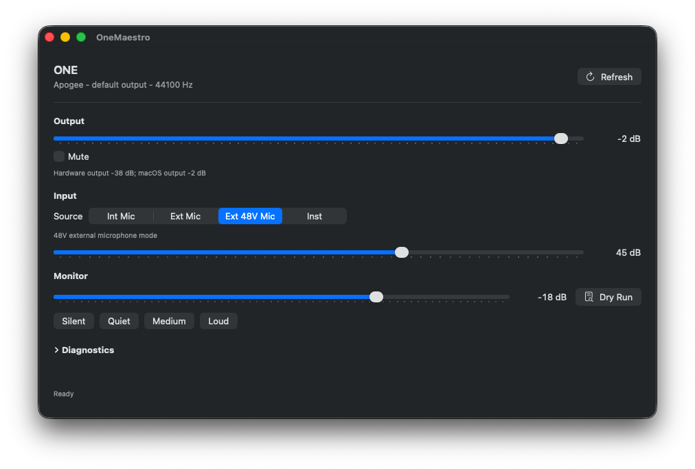

# OneMaestro

A small macOS utility for controlling the original Apogee ONE USB interface on
modern macOS, without relying on the legacy Apogee Maestro app.

The app keeps Core Audio in charge of audio streaming and talks to the device
only for Maestro-style hardware controls: output level/mute, input source,
input gain, and direct monitoring volume.



## Status

This is a working local prototype for the original Apogee ONE USB
(`0x0c60:0x0003`). It has been tested against one connected unit on macOS Tahoe
26.3.1.

Implemented:

- Main output level and mute
- Input source selection: `Int Mic`, `Ext Mic`, `Ext 48V Mic`, and `Inst`
- Input gain for the selected source
- Direct monitor volume through the confirmed direct-input monitor mix send
- Core Audio output-volume tracking, so the app follows macOS volume changes when the ONE is the default system output
- A compact diagnostics panel for USB, Core Audio, UAC, and monitor request state

Known limits:

- This is not an App Store-sandboxed app.
- The CLI opens the ONE through `IOUSBHost`; run one helper command at a time.
- Direct monitor volume has no hardware readback path, so the app persists the
  last requested value.
- Phantom power and Hi-Z are exposed as input source modes, not independent
  toggles, until separate hardware controls are verified.

## Requirements

- macOS with Swift, clang, and the Apple developer command line tools
- Original Apogee ONE USB interface connected
- A local build; no binary release is published yet

## Build

```sh
make one-control
make app
make package
```

Build outputs:

- `.build/one-control`
- `.build/OneMaestro.app`
- `.build/OneMaestro.zip`

Open the app:

```sh
open .build/OneMaestro.app
```

## CLI

Useful read commands:

```sh
.build/one-control status
.build/one-control status --json
.build/one-control output --json
.build/one-control input --json
.build/one-control monitor --json
.build/one-control self-test
```

Examples that change hardware state:

```sh
.build/one-control input --source inst
.build/one-control output --macos-volume-db -24
.build/one-control monitor --volume-db -48
```

`self-test` performs no-op writes: it writes current values back to the same
controls, then verifies readback.

## Monitoring

`monitor --volume-db` uses the audible, confirmed direct-input monitor mix send
from the legacy `ONEUSB::UpdateLLM()` path. Raw hardware values are inverted:
`0` is loud and `63` is silent or near-silent, so the CLI exposes a conventional
`-63..0 dB` user range.

The older `bRequest=0x06` attenuation path is still available as
`--legacy-volume-db`/`--legacy-attenuation-db`; the device accepts it, but live
tests did not find an audible monitoring change.

The app exposes monitor presets at `-63`, `-54`, `-36`, and `-18 dB`.

`output --system-volume-db` targets macOS's current default system output device, not the ONE unconditionally. The app only uses this Core Audio path when the ONE is itself the default system output; otherwise its output slider continues to control the ONE's hardware output.

## Hardware Notes

Current observed device:

- USB vendor: Apogee (`0x0c60`)
- USB product: ONE (`0x0003`)
- USB Audio Class: UAC1, full-speed USB, 24-bit PCM at 44.1/48 kHz
- Streams advertised by descriptors: 2-channel output, 1-channel input

On this Mac, Core Audio exposes `ONE` as an Apogee USB audio device with 1 input
channel and 2 output channels. In the Codex sandbox, Core Audio enumeration and
`IOUSBHost` writes may be blocked; run live hardware checks outside the sandbox.

## Documentation

- [Project plan](docs/apogee-one-maestro-plan.md)
- [Reverse-engineering notes](docs/legacy-one-reverse-engineering.md)
- [Operator test checklist](docs/operator-test-checklist.md)

## Publishing Checklist

Before making the GitHub repository public:

- Decide whether to attach `.build/OneMaestro.zip` as a release artifact.
- Run the [operator test checklist](docs/operator-test-checklist.md) on the
  target Mac with the ONE connected.
- Add any hardware compatibility notes from additional ONE units.

## License

MIT. See [LICENSE](LICENSE).
